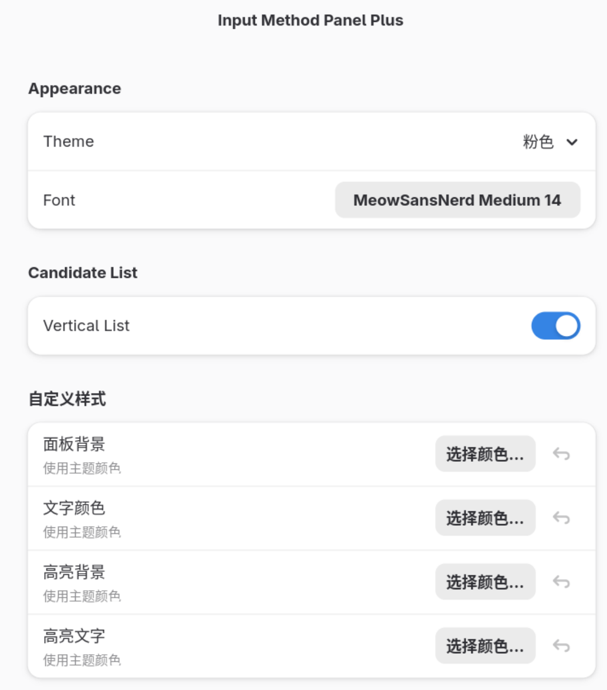
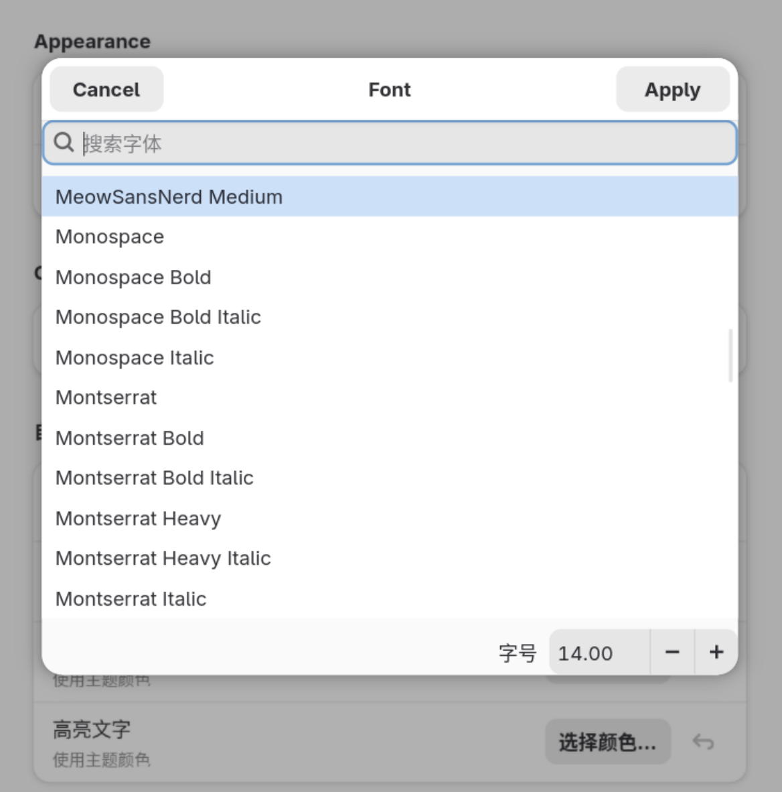
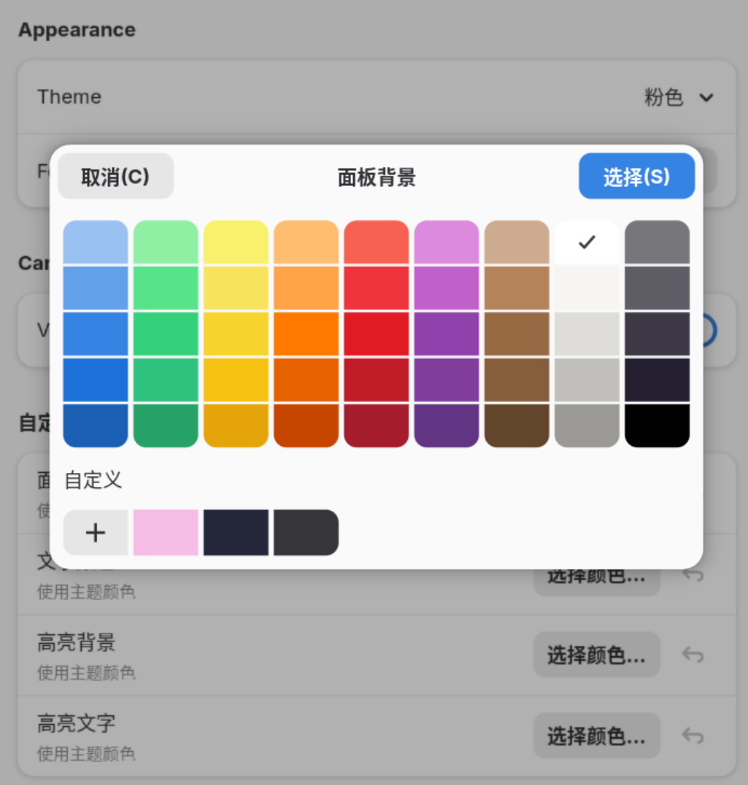

Kimpanel Plus
=============

Kimpanel Plus displays the Fcitx5 candidate panel in GNOME Shell using the KDE
Kimpanel protocol. It adds a searchable system font picker, candidate
highlight themes, and individual color overrides.

Install
-------

You need GNOME Shell 51, Fcitx5 with its Kimpanel addon enabled, and the
following build tools: CMake, Make, gettext, zip, unzip, and
`glib-compile-schemas` from GLib.

Run from the project directory:

    ./install.sh

The script installs the extension for the current user. On Wayland, log out
and back in after the first installation so GNOME Shell discovers it. Then
enable it and open its settings:

    gnome-extensions enable kimpanel-plus@kamiertop
    gnome-extensions prefs kimpanel-plus@kamiertop

If another Kimpanel extension is enabled, disable it before enabling
Kimpanel Plus so the two extensions do not compete for the same D-Bus name.
Switch to a Fcitx5 input method and type to bring up the candidate panel.

Configure the candidate panel
-----------------------------

- **Vertical List** puts candidates in a column when the input method leaves
  the layout preference to the panel.
- **Theme** sets the base colors for the selected candidate while keeping the
  GNOME Shell panel layout and background. The highlight follows the input
  method's selection, independently of the mouse hover state.

The built-in themes are:

- **Default** follows the GNOME Shell style.
- **Pink** uses the background `#f5bde6` and text `#24273a` from the Fcitx5
  Catppuccin Macchiato Pink theme (`catppuccin-macchiato-pink/theme.conf`).
- **Blue** uses the background `#89b4fa` and text `#1e1e2e` from the Fcitx5
  Catppuccin Mocha Blue theme (`catppuccin-mocha-blue/theme.conf`).

The Fcitx5 themes credit justTOBBI, Isabelinc, and Kurome. Kimpanel Plus uses
their candidate highlight colors.

Choose a font
-------------

**Font** lists installed font families and faces. Search ignores case, spaces,
and punctuation, and accepts abbreviations such as `jbmono` for JetBrains
Mono. Choose a face and font size, then click **Apply**.

Custom colors
-------------

Under **Custom Style**, choose colors for **Panel Background**, **Text
Color**, **Highlight Background**, and **Highlight Text**. Text Color applies
to ordinary candidates and composition text. The two highlight settings
apply to the candidate currently selected by the input method.

Click **Choose Color** and confirm the color. The setting is applied
immediately and the button displays its swatch and hex value. Color overrides
are kept when switching themes. To restore a single color, use the undo
button next to it. The row will show **Use Theme Color** and follow the
currently selected theme.

Preview changes without logging out
-----------------------------------

- To preview changes to the settings page, install the updated files, close
  the settings window, and open it again with
  `gnome-extensions prefs kimpanel-plus@kamiertop`. The settings page runs in
  a separate process.
- To test changes to the Shell-side panel code on Wayland, launch a nested
  development session with `dbus-run-session gnome-shell --devkit --wayland`.
  Enable the extension and run Fcitx5 on the nested session's D-Bus to test
  actual candidates. Restart the nested session to reload Shell-side code.
  See the GNOME Shell extension debugging guide at
  https://gjs.guide/extensions/development/debugging.html.

Translations: https://www.transifex.com/fcitx/fcitx/gnome-shell-extensions-kimpanel/
